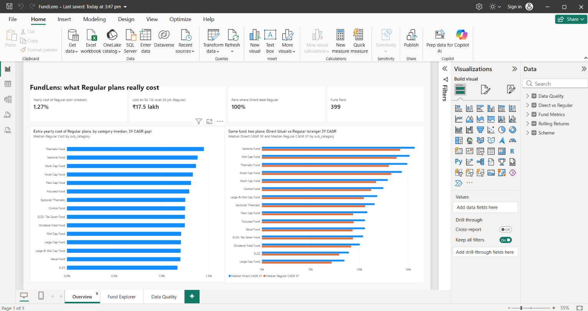
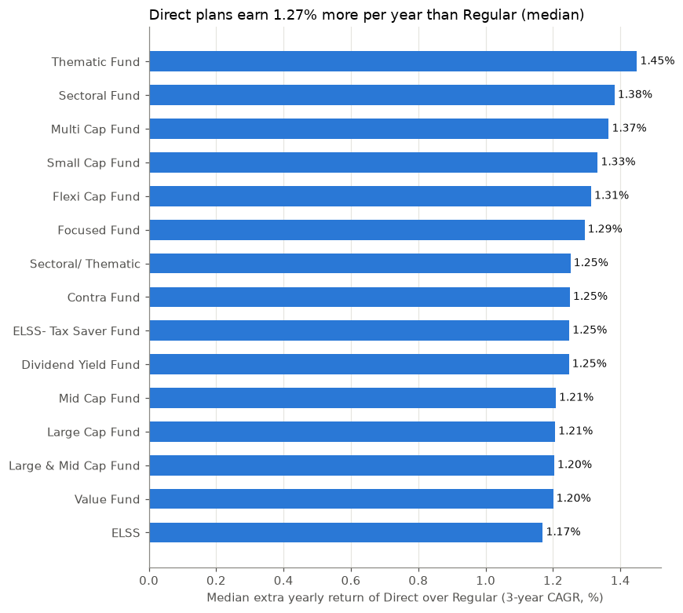
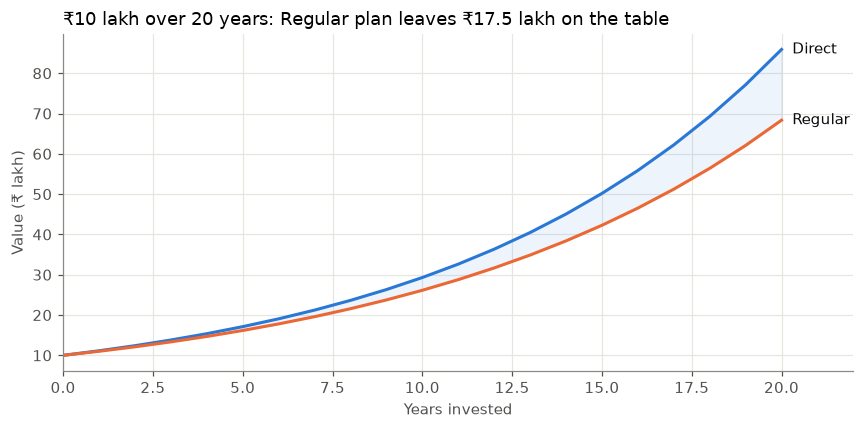
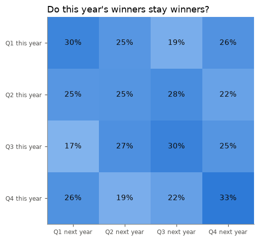
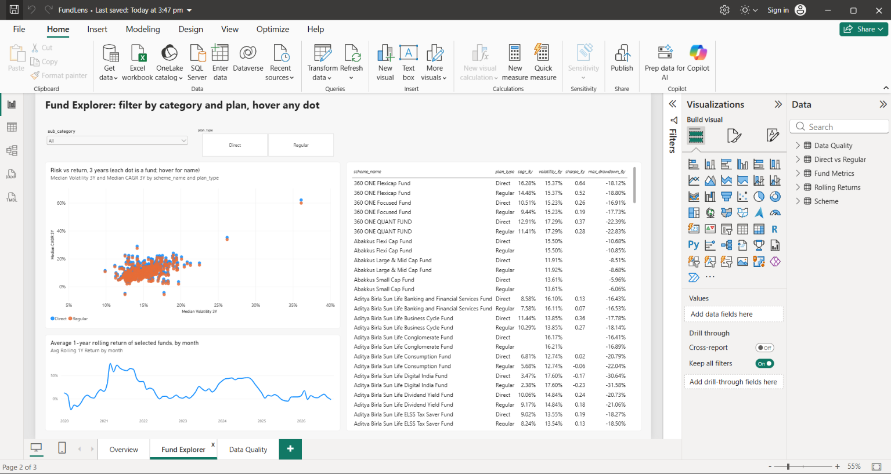

# FundLens: What Regular Mutual Fund Plans Really Cost Indian Investors

An end-to-end data platform for Indian mutual funds: a Python ingestion pipeline, a PostgreSQL warehouse modelled with dbt, an analysis notebook and a Power BI dashboard, refreshed automatically every day.

The headline question: **every Indian mutual fund is sold in two versions, Direct and Regular, holding exactly the same portfolio. The Regular plan pays a distributor commission out of your returns. How much does that cost?**



---

## Key findings

| Finding | Result |
|---|---|
| Direct vs Regular fund pairs compared | **399** |
| Median extra yearly cost of the Regular plan (3-year CAGR gap) | **1.27% a year** |
| Pairs where Direct beat Regular | **100%** |
| Cost of that gap on ₹10 lakh over 20 years | **₹17.5 lakh** |
| Correlation between 3-year volatility and 3-year return | **0.58** |
| Top-quartile funds still top-quartile the next year | **30%** (25% = pure chance) |

1. **Regular plans cost about 1.27% a year, in every category.** Because both plans hold the same stocks, Direct won in all 399 pairs. That gap compounds to ₹17.5 lakh on a ₹10 lakh investment over 20 years.
2. **Riskier funds did pay more over the last 3 years, but only moderately** (correlation 0.58).
3. **Past winners rarely stay winners.** Only 30% of a category's top-quartile funds stay in the top quartile the following year, barely above the 25% expected by luck. Picking funds by last year's return is close to a coin flip.





## Architecture

```
AMFI daily NAV file ──┐                       ┌── staging (views: clean, typed)
(all ~14k schemes)     │   Python ETL          │
                       ├──► PostgreSQL raw ──► dbt ──┼── core: dim_scheme (SCD2), fct_nav_daily (incremental)
mfapi.in history  ─────┘   (Jupyter)           │
(equity schemes, 2019+)                        ├── intermediate: spike-cleaned NAV + daily returns
                                               └── marts: fund metrics, rolling returns,
                                                   Direct vs Regular, data-quality report
                                                          │
                                         Power BI dashboard + analysis notebook
```

Every day `run_daily.py` (Windows Task Scheduler) runs the extract, checks source freshness and runs `dbt build`, writing a log to `logs/`.

## Data engineering decisions

| Decision | Why |
|---|---|
| **Raw → staging → core → marts layers** | Raw data is kept untouched, so any model can be rebuilt from it. |
| **Idempotent upserts** (`INSERT … ON CONFLICT` through a temp table, in one transaction) | Re-running a load never creates duplicates or half-written data. |
| **Raw files archived** before parsing | Any day's load can be replayed and audited. |
| **Columns found by header name**, not position | The AMFI file has changed layout before; schema drift won't silently shift columns. |
| **Rejected rows kept with a reason**, plus a `load_log` run table | Bad rows are visible, not silently dropped. |
| **Parallel, resumable backfill** (5 workers, retries with backoff, batches of 100, per-scheme status table) | A failed or interrupted history download resumes where it stopped. |
| **SCD Type 2 scheme dimension** (dbt snapshot) | Fund renames and SEBI re-categorisations keep their history. |
| **Incremental fact table** | Daily runs only reprocess scheme-days with new data. |
| **Spike cleaning**: a >15% jump that fully reverses the next day is removed | Bad one-day prints from the source would otherwise distort volatility and drawdown. Real crashes, such as March 2020, are kept and flagged. |
| **dbt tests**: uniqueness, not-null, relationships, one current row per scheme, positive NAV, source freshness, plus warning-level sanity checks | Quality problems stop or flag the pipeline instead of reaching the dashboard. |

The data-quality checks found **53 issues across 35 schemes**: 2 fake price spikes removed, gaps in price history, prices that didn't change for 5 days, and large real moves kept (mostly March 2020). They are listed on the Data Quality page of the dashboard.

## Metrics (dbt marts)

- **Returns:** 1-year return, 3- and 5-year CAGR
- **Risk:** annualised volatility, downside volatility, max drawdown (3 years)
- **Risk-adjusted:** Sharpe and Sortino ratios (6.5% risk-free rate, set as a dbt variable)
- **Rank:** position within category, Direct and Regular ranked separately
- **Rolling returns:** 1-year and 3-year rolling returns at each month-end
- **Direct vs Regular:** the two plans of the same fund matched by fund house, category and normalised name

## Dashboard (Power BI)

- **Overview:** headline numbers, cost of Regular by category, Direct vs Regular returns
- **Fund Explorer:** category and plan filters, risk-vs-return scatter, fund table, rolling-return trend
- **Data Quality:** issues found by the pipeline, by type and by fund



## Project structure

```
FundLens/
├── notebooks/
│   ├── 00_setup_check.ipynb          # DB connection check
│   ├── 01_extract_amfi_daily.ipynb   # daily AMFI extract: parse, validate, upsert, run log
│   ├── 02_backfill_history.ipynb     # parallel, resumable history backfill
│   ├── 03_dbt_models.ipynb           # dbt staging + core models, SCD2 snapshot
│   ├── 04_metrics_marts.ipynb        # returns, risk, Direct vs Regular, data-quality marts
│   └── 05_analysis.ipynb             # findings and charts
├── fundlens_dbt/                     # dbt project (models, snapshots, tests, macros)
├── images/                           # charts and dashboard screenshots
├── FundLens.pbix                     # Power BI dashboard
├── run_daily.py                      # scheduled daily pipeline
└── requirements.txt
```

## Run it yourself

1. Install PostgreSQL and create a database called `fundlens`.
2. `python -m venv venv`, then `venv\Scripts\activate`, then `pip install -r requirements.txt`
3. Create a `.env` file containing `DATABASE_URL=postgresql+psycopg://postgres:<password>@localhost:5432/fundlens`
4. Run notebooks `01` → `05` in order.
5. Open `FundLens.pbix` and click **Refresh**.
6. Optional: schedule `venv\Scripts\python.exe run_daily.py` in Windows Task Scheduler.

## Limitations

- The returns gap measures the total cost difference between the plans (mostly commission). It is not an exact expense-ratio figure.
- Direct and Regular plans are matched by name; the 100% Direct win rate is a check that the matching is accurate.
- History starts in 2019 and only open-ended equity growth schemes are tracked.
- This is analysis, not investment advice.

## Tech stack

Python · pandas · SQLAlchemy · PostgreSQL · dbt · Jupyter · matplotlib · Power BI · Windows Task Scheduler

## Data

NAV data from [AMFI](https://www.amfiindia.com) and [mfapi.in](https://www.mfapi.in).

## Author

**Chetan Kumar** · [GitHub @chetank-github](https://github.com/chetank-github) · [LinkedIn](https://www.linkedin.com/in/chetank-ln/)
